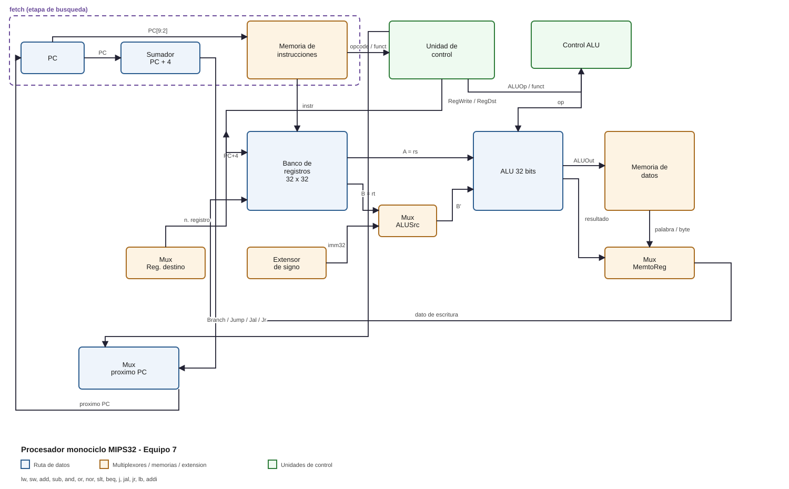

# Laboratorio 03 - Diseño y verificación del procesador monociclo

**Arquitectura de Computadores y Laboratorio - 2026-2**

| | |
|---|---|
| **Equipo** | 7 |
| **Integrantes** | Iván René Acosta Lallemand · Manuel Felipe Álvarez Rúa |
| **Instrucciones adicionales** | `LB` (*load byte*) y `ADDI` (*add immediate*) |
| **Problema asignado** | Primeros diez elementos de `S(n) = 2·S(n-1) + S(n-2)`, `S(0)=0`, `S(1)=1` |
| **Herramienta** | Logisim Evolution 4.1.0 (archivo en formato 3.8.0) |
| **Archivo de diseño** | `ALU32.circ` |

---

## 1. Objetivo

Implementar como procesador monociclo una versión reducida de la arquitectura
MIPS32, extendiendo el repertorio básico (`lw`, `sw`, `add`, `sub`, `and`,
`or`, `nor`, `slt`, `beq`, `jump`) con las instrucciones `jal`, `jr`, `lb` y
`addi`, y utilizarlo para resolver el problema asignado mediante un programa
en ensamblador que usa procedimientos y respeta la convención de registros
MIPS.

---

## 2. Arquitectura implementada

### 2.1 Organización del proyecto

El diseño es jerárquico y está contenido en `ALU32.circ`. El circuito
principal es **`Main`**; los demás circuitos son subcircuitos reutilizables:

| Circuito | Función |
|---|---|
| `Main` | Nivel superior: instancia los bloques y contiene los multiplexores, sumadores, divisores, extensores y compuertas de interconexión. |
| `Fetch_instruction` | Registro `PC`, sumador `PC+4` y ROM de instrucciones de 256 × 32 bits. |
| `intruction_format` | Separa la instrucción en `Op_code`, `rs`, `rt`, `rd`, `shamt`, `funct`, `inmediate` y `address`. |
| `controller` | Decodifica el `OpCode` y genera las señales de control. |
| `ALU_control` | Decodifica `ALUoperation` y `funct`; entrega `ALUOperation` (4 bits) y `JR`. |
| `register_bank` | 32 registros de 32 bits, lectura asíncrona, escritura síncrona y `$zero` inmutable. |
| `ALU32bits` | ALU de 32 bits construida a partir de la ALU de 1 bit `ALU1` y de `ALU1MSB`. |
| `FullAdder` | Sumador completo de 1 bit usado por `ALU1` y `ALU1MSB`. |
| `ALU1` / `ALU1MSB` | ALU de 1 bit (la versión MSB genera además la señal `Set` para `slt`). |
| `DataMemory` | RAM de datos de 256 × 32 bits, con lectura asíncrona y escritura en flanco de subida. |

Las conexiones de `Main` se hicieron con **túneles con nombre** en los puertos
de los bloques y con **cables cortos** hacia las etiquetas; en los grupos
locales (ALU Src, load byte, siguiente PC y writeback) se usan cables directos
entre las primitivas. Esto sigue la recomendación de la guía, evita cruces
accidentales y permite leer el circuito como un diagrama de bloques
(`PCplus4`, `Instruction`, `ReadData1`, `ALUresult`, etc.). El reloj y el reset
entran por los pines `clk` y `reset`.

Para que los componentes se distingan, los siete bloques de `Main` usan una
apariencia de **caja negra con título inferior y etiquetas blancas**; las
primitivas quedaron agrupadas y rotuladas por función. Los circuitos internos
(`Fetch_instruction`, `DataMemory`, etc.) conservan el estilo de cableado del
archivo original.



*Figura 1. Diagrama de bloques de la ruta de datos y de las unidades de
control. El esquemático completo está en `ALU32.circ`; el diagrama vectorial
está en `diagrama_procesador.svg`.*

### 2.2 Etapa de búsqueda (`Fetch_instruction`)

- Registro `PC` de 32 bits, con `reset` asíncrono y habilitación permanente.
- Sumador de 32 bits que calcula `PC+4` (`PCplus4`).
- ROM de 256 palabras × 32 bits. La dirección de la ROM es **`PC[9:2]`**:
  la memoria de instrucciones es direccionada por palabra y el `PC` avanza de
  a 4 bytes. Así, la instrucción de la dirección `0x00000000` ocupa la palabra
  0 de la ROM, la de `0x00000004` la palabra 1, etc.
- El programa de 71 instrucciones ocupa las palabras 0 a 70; el resto de la
  ROM queda en cero.

### 2.3 Formato de instrucción (`intruction_format`)

Un primer divisor separa `Op_code = Instruction[31:26]` y
`address = Instruction[25:0]`. Un segundo divisor obtiene `rs`, `rt` e
`inmediate`; un tercero obtiene `rd`, `shamt` y `funct`. `shamt` no se usa en
este laboratorio.

### 2.4 Banco de registros (`register_bank`)

Se instanciaron 32 registros de 32 bits de la biblioteca (`Memory → Register`).
La escritura se habilita con un decodificador 5→32 cuya entrada es el registro
destino y cuyo *enable* es `enable_write`. Las dos lecturas se hacen con
multiplexores 32:1 controlados por `Bit_register_1` (`rs`) y
`Bit_register_2` (`rt`), de modo que la lectura es asíncrona y la escritura
ocurre en el flanco de subida.

El registro `$zero` tiene `D = 0`; aunque el decodificador habilite su
escritura, siempre se recarga con cero. El `Reset` limpia todos los registros
al inicio de la simulación.

### 2.5 Unidad de control (`controller`)

El controlador es combinacional y se implementó con comparadores de 6 bits
(uno por opcode), compuertas OR y compuertas AND. La tabla obtenida es:

| Instrucción | Opcode | ALUsource | RegDestino | Jump | Branch | MemRead | MemToReg | MemWrite | RegWrite | ALUoperation | LoadByte |
|---|---|---|---|---|---|---|---|---|---|---|---|
| tipo R | `000000` | 0 | 1 | 0 | 0 | 0 | 0 | 0 | 1 | `10` | 0 |
| `j` | `000010` | 0 | 0 | 1 | 0 | 0 | 0 | 0 | 0 | `00` | 0 |
| `beq` | `000100` | 0 | 0 | 0 | 1 | 0 | 0 | 0 | 0 | `01` | 0 |
| `addi` | `001000` | 1 | 0 | 0 | 0 | 0 | 0 | 0 | 1 | `00` | 0 |
| `lb` | `100000` | 1 | 0 | 0 | 0 | 1 | 1 | 0 | 1 | `00` | 1 |
| `lw` | `100011` | 1 | 0 | 0 | 0 | 1 | 1 | 0 | 1 | `00` | 0 |
| `sw` | `101011` | 1 | 0 | 0 | 0 | 0 | 0 | 1 | 0 | `00` | 0 |

La instrucción `jal` (opcode `000011`) se decodifica en `Main` con un
comparador adicional `OpCode == 3`. La señal `Jal` se combina con `Jump`,
`RegDestino` y `RegWrite`, y activa el multiplexor que escribe `PC+4` en el
registro `$31`. El controlador no necesita una salida nueva: la lógica de
`jal` queda en el nivel superior, junto a los multiplexores de la ruta de
datos.

### 2.6 Control de la ALU y ALU de 32 bits

`ALU_control` recibe `ALUoperation` (2 bits) y `funct` (6 bits) y produce
`ALUOperation` (4 bits) y `JR`:

- `ALUoperation = 00` → suma (`ALUOperation = 0010`).
- `ALUoperation = 01` → resta (`ALUOperation = 0110`).
- `ALUoperation = 10` → según `funct`:
  - `add` (`0x20`) → `0010`
  - `sub` (`0x22`) → `0110`
  - `and` (`0x24`) → `0000`
  - `or`  (`0x25`) → `0001`
  - `nor` (`0x27`) → `1100`
  - `slt` (`0x2a`) → `0111`
  - `jr`  (`0x08`) → `ALUOperation` irrelevante y `JR = 1`.

Los cuatro bits de `ALUOperation` se interpretan en `ALU32bits` como
`{Ainvert, Binvert, Operation[1:0]}`. `Operation = 00` es AND, `01` es OR,
`10` es suma y `11` es SLT. La ALU de 32 bits usa 31 copias de `ALU1` y una
copia de `ALU1MSB` (el bit más significativo); la cadena de acarreo se
propaga bit a bit y la señal `ZERO` se obtiene con una OR de 32 entradas y un
inversor.

### 2.7 Memoria de datos y `LB` (`DataMemory` + `Main`)

La RAM es de 256 palabras × 32 bits, con lectura asíncrona
(`asyncread = true`) y escritura en flanco de subida. La dirección de palabra
se toma de **`Address[9:2]`**; los bits `Address[1:0]` son el desplazamiento
de byte.

El camino de `LB` está en `Main`:

1. `MemData` (salida de la RAM) se parte en cuatro bytes con un divisor de
   `32 → 4 × 8`.
2. Un **multiplexor 4:1 de 8 bits** selecciona el byte con `ALUresult[1:0]`,
   tal como indica la guía. Los cuatro bytes llegan por túneles en columna
   (`Byte0`…`Byte3`) y se conectan al multiplexor con cables cortos en
   carriles separados.
3. Un *Bit Extender* de 8 a 32 bits en modo `sign` extiende el byte con signo.
4. Un multiplexor controlado por `LoadByte` elige entre la palabra completa
   (`lw`) y el byte extendido (`lb`).
5. El multiplexor `MemToReg` elige entre `ALUresult` y el dato de memoria.

### 2.8 Cálculo del próximo `PC`, `jal` y `jr`

- `PCplus4` es la salida secuencial de `Fetch_instruction`.
- El destino de `beq` se calcula con un sumador de 32 bits:
  `PCplus4 + (SignImm << 2)`. El desplazamiento se implementa con divisores:
  se toma `SignImm[29:0]` y se coloca en los bits `[31:2]`, con `00` en los
  bits `[1:0]`.
- `PCSrc = Branch AND ZERO`. El primer multiplexor elige `PCplus4` o el destino
  de `beq`.
- El destino de `j`/`jal` se arma con un divisor de 32 bits y tres grupos:
  `PCplus4[31:28]`, `address[25:0]` y `00`.
- El segundo multiplexor elige entre la salida anterior y el destino de
  salto. Su selector es `Jump OR Jal`.
- El tercer multiplexor elige entre la salida anterior y `ReadData1` cuando
  `JR = 1`.
- Para `jal`, el registro destino se fuerza a `11111` con un multiplexor
  controlado por `Jal`, y el dato escrito se selecciona con otro multiplexor
  que elige `PC+4`.

### 2.9 Bloques y primitivas de `Main`

`Main` instancia los siete bloques funcionales (`Fetch_instruction`,
`intruction_format`, `controller`, `ALU_control`, `register_bank`,
`ALU32bits`, `DataMemory`) y contiene las siguientes primitivas:

- Extensor de signo de 16 a 32 bits para el inmediato.
- Multiplexor de 32 bits para la segunda entrada de la ALU (`ALUsource`).
- Multiplexor de 5 bits para el registro destino (`rt`/`rd`).
- Multiplexor de 5 bits adicional para forzar `$31` en `jal`.
- NOT y AND para `enable_write = RegWrite AND NOT JR`.
- Sumador de 32 bits para el destino de `beq`.
- Divisores para `SignImm << 2` y para el destino de salto.
- AND para `PCSrc`, y tres multiplexores de 32 bits para el próximo `PC`.
- Divisor de `MemData` en bytes, multiplexor 4:1, extensor 8→32 y
  multiplexores de `LoadByte`, `MemToReg` y `jal`.
- Comparador de 6 bits y tres compuertas OR para la lógica de `jal`.

---

## 3. Programa solución

### 3.1 Pseudocódigo

```
main:
    escribir configuracion:  memoria[0x200] = 0x0000020A   (byte 0 = N = 10)
    N  = lb(0x200)                    # LB
    base = 0x100
    S(9) = serie(N, base)             # procedimiento
    memoria[0x300] = S(9)
    (suma, cantidad) = checksum(N, base)   # procedimiento
    memoria[0x304] = suma
    memoria[0x308] = cantidad
    leer de vuelta 0x300, 0x304, 0x308 y 0x124 en $s3..$s6
    fin: j fin

serie(N, base):
    guardar $ra, $s1, $s2 en la pila
    s1 = S(0) = 0 ; s2 = S(1) = 1 ; i = 0 ; p = base
    mientras i < N:
        si i == 0:      S = 0
        si i == 1:      S = 1
        si no:          S = 2*s2 + s1 ; s1 = s2 ; s2 = S
        memoria[p] = S ; p = p + 4 ; i = i + 1
    v0 = s2
    restaurar $ra, $s1, $s2 ; jr $ra

checksum(N, base):
    guardar $ra en la pila
    suma = 0 ; cantidad = 0 ; i = 0
    mientras i < N:
        suma = suma + lb(base + 4*i)     # LB con extension de signo
        cantidad = cantidad + 1 ; i = i + 1
    restaurar $ra ; jr $ra
```

### 3.2 Convención de registros

| Registro | Uso en el programa |
|---|---|
| `$zero` | constante 0 |
| `$v0`, `$v1` | valores de retorno de los procedimientos |
| `$a0`, `$a1`, `$a2` | argumentos: `N`, base del arreglo, base de resultados |
| `$t0`–`$t3` | temporales (contadores, punteros, valores intermedios) |
| `$s1`, `$s2` | registros salvados: `S(n-2)` y `S(n-1)` |
| `$s3`–`$s6` | resultados leídos de memoria |
| `$sp`, `$ra` | pila y dirección de retorno |

Los procedimientos salvan y restauran los registros que usan, y usan
`jal`/`jr` para llamar y retornar.

### 3.3 Código ensamblador

El código completo está en `solucion_lab03.asm`. Consta de 71 instrucciones
(284 bytes).

### 3.4 Código de máquina

El listado completo, con dirección, código hexadecimal, binario e instrucción,
está en `codigo_maquina.txt`. La ROM de 256 × 32 bits se carga con las 71
palabras en las direcciones 0 a 70 (direccionamiento por palabra, `PC[9:2]`).

Las primeras instrucciones son:

| Dirección | Código | Instrucción |
|---|---|---|
| `0x00000000` | `0x20080200` | `addi $t0, $zero, 512` |
| `0x00000004` | `0x2009020A` | `addi $t1, $zero, 522` |
| `0x00000008` | `0xAD090000` | `sw $t1, 0($t0)` |
| `0x0000000C` | `0x81040000` | `lb $a0, 0($t0)` |
| `0x00000010` | `0x20050100` | `addi $a1, $zero, 256` |
| `0x00000014` | `0x0C000012` | `jal 0x00000048` |

La última instrucción del procedimiento de checksum es
`0x00000118: 0x03E00008  jr $ra`.

### 3.5 Mapa de memoria

| Dirección | Contenido | Escrito por |
|---|---|---|
| `0x00000200` | `0x0000020A` (byte 0 = 10 = N) | `main` |
| `0x00000100` … `0x00000124` | `S(0)` … `S(9)` | `serie` |
| `0x00000300` | `985` (`S(9)`) | `main` |
| `0x00000304` | `0xFFFFFF91` (checksum) | `main` |
| `0x00000308` | `10` (cantidad) | `main` |

La RAM es de 256 palabras × 32 bits y arranca en cero. El índice de palabra
es `Address[9:2]`; por eso `0x100` corresponde al índice `0x40`, `0x200` al
`0x80` y `0x300` al `0xC0`. La pila usa `0xFFFFFFF4` … `0xFFFFFFFC`
(índices `0xFD` … `0xFF`). Ver `memoria_datos_inicial.txt`.

---

## 4. Verificación

### 4.1 Metodología

La verificación se hizo en dos niveles con el simulador de Logisim Evolution
en modo *headless*:

1. **Bloque por bloque:** se aplicaron entradas a cada subcircuito y se
   compararon las salidas con los valores esperados.
2. **Programa completo:** se ejecutó `Main` desde el reset durante 350 ciclos
   y se registraron, ciclo a ciclo, la instrucción, el registro destino, el
   dato escrito, las señales de memoria y el `PC`. Con esos datos se
   reconstruyeron el banco de registros y la memoria de datos al final.

Para observar las señales internas se usó una copia de verificación con pines
de salida temporales (`PCplus4`, `Instruction`, `WriteReg`, `WriteData`,
`RegWriteEn`, `MemWrite`, `ALUresult`, `MemData`, `ReadData2`). El archivo
entregado, `ALU32.circ`, conserva únicamente los pines `clk` y `reset` en
`Main`.

### 4.2 Verificación por bloque

| Bloque | Prueba realizada | Resultado |
|---|---|---|
| `ALU32bits` | ADD, SUB, AND, OR, NOR y SLT con pares `5/3`, `3/5`, `0xFFFFFFFF/1`, `10/10`; se revisaron `Result` y `ZERO`. | Correcto |
| `register_bank` | Escritura y lectura de `$8` con `0x12345678`; escritura a `$zero`; lectura de `$zero`. | Correcto: `$8` conserva el dato y `$zero` siempre vale 0 |
| `controller` | Opcodes `0x00`, `0x02`, `0x03`, `0x04`, `0x08`, `0x20`, `0x23`, `0x2B`; se compararon las 10 salidas. | Coincide con la tabla de la sección 2.5; `jal` se detecta en `Main` |
| `ALU_control` | `ALUoperation = 0,1,2` con `funct = 0x20, 0x22, 0x24, 0x25, 0x27, 0x2A, 0x08`. | Correcto; `JR` solo se activa con `funct = 0x08` |
| `Fetch_instruction` | Reset, avance de `PC` y lectura de la ROM en `PC = 0` y `PC = 4`. | `0x20080200` y `0x2009020A`, respectivamente |
| `DataMemory` | Escritura/lectura en `0x100` y `0x300`, y lectura de `0x104`. | Palabras independientes y correctas |
| `intruction_format` | Separación de los campos de las 71 instrucciones. | Correcto |

### 4.3 Resultados del programa completo

| Programa | Instrucciones | Ciclos simulados | Resultado |
|---|---|---|---|
| `solucion_lab03.asm` | 71 | 350 | **Sin discrepancias; el PC se detiene en `0x00000044`** |

Al finalizar la simulación:

```
S(0..9) = 0, 1, 2, 5, 12, 29, 70, 169, 408, 985

Memoria:
  0x100 = 0x00000000   0x104 = 0x00000001
  0x108 = 0x00000002   0x10C = 0x00000005
  0x110 = 0x0000000C   0x114 = 0x0000001D
  0x118 = 0x00000046   0x11C = 0x000000A9
  0x120 = 0x00000198   0x124 = 0x000003D9
  0x200 = 0x0000020A
  0x300 = 0x000003D9
  0x304 = 0xFFFFFF91
  0x308 = 0x0000000A

Registros:
  $v0 = 0xFFFFFF91 (-111)   $v1 = 0x0000000A (10)
  $s3 = 0x000003D9 (985)    $s4 = 0xFFFFFF91 (-111)
  $s5 = 0x0000000A (10)     $s6 = 0x000003D9 (985)
  $ra = 0x00000028          $t3 = 0x00000128
```

El valor `-111` se explica porque `LB` extiende el signo: los bytes bajos
`0xA9`, `0x98` y `0xD9` (de `S(7)`, `S(8)` y `S(9)`) se interpretan como
`-87`, `-104` y `-39`. Esto evidencia el funcionamiento correcto de la
extensión de signo de `LB`.

---

## 5. Decisiones de diseño y correcciones

- **Memoria de instrucciones direccionada por palabra.** La ROM es de
  256 × 32 bits y usa `PC[9:2]`. Es suficiente para las 71 instrucciones y
  evita desperdiciar una palabra por cada byte de dirección.
- **Memoria de datos direccionada por palabra.** La RAM usa `Address[9:2]`
  como índice y `Address[1:0]` como desplazamiento de byte. Así `lw`, `sw` y
  `lb` comparten el mismo espacio de direcciones y `lb` puede seleccionar
  cualquiera de los cuatro bytes.
- **`LB` en `Main`.** El divisor de bytes, el multiplexor 4:1 y el extensor
  de signo se dejaron en el nivel superior, tal como indica la guía. Esto
  permite reutilizar la misma salida de RAM para `lw` y `lb`.
- **`jal` decodificado en `Main`.** En lugar de modificar la estructura de
  compuertas del controlador, se agregó un comparador `OpCode == 3`. Sus OR
  con `Jump`, `RegDestino` y `RegWrite` activan el salto, la escritura y la
  selección de `$31`; un multiplexor final escribe `PC+4`. Esto mantiene el
  controlador estable y hace explícita la lógica de enlace.
- **`jr` mediante `ALU_control`.** El funct `0x08` activa `JR`; el
  controlador ve un opcode tipo R y pone `RegWrite = 1`, pero la AND con
  `NOT JR` apaga la escritura y el multiplexor final del `PC` selecciona
  `ReadData1`.
- **`$zero` inmutable.** El registro tiene `D = 0` y el decodificador no
  puede alterar su valor; la lectura entrega siempre cero.
- **Lectura asíncrona y escritura síncrona.** El banco de registros y la RAM
  se leen de forma combinacional y se escriben en el flanco de subida, lo que
  permite completar cada instrucción en un ciclo.
- **Conexiones con túneles.** `Main` usa túneles con nombre en cada puerto.
  La guía los recomienda para evitar cables rojos por anchos incompatibles y
  para que el esquemático se lea como un diagrama de bloques.
- **Correcciones realizadas durante la verificación.** Se corrigieron la
  dirección de la ROM (`PC[9:2]`), la dirección de la RAM (`Address[9:2]`),
  el destino de `jal` (debe ser `$31`, no el campo `rd`), el camino de `LB`,
  el cálculo de `SignImm << 2` y del destino de salto, y la extensión de
  signo del byte (8→32). También se completó el atributo `appear` de los
  divisores, necesario para que Logisim los simule correctamente.

---

## 6. Conclusiones

- Se implementó y verificó un procesador monociclo MIPS32 que ejecuta las
  diez instrucciones básicas más `jal`, `jr`, `lb` y `addi`.
- El diseño quedó organizado en 11 circuitos jerárquicos, con `Main` como
  nivel superior y subcircuitos separados para búsqueda, formato, control,
  control de ALU, banco de registros, ALU de 32 bits y memoria de datos.
- El banco de registros es jerárquico (32 registros de 32 bits), con lectura
  asíncrona, escritura síncrona y `$zero` inmutable.
- El programa solución usa procedimientos (`jal`/`jr`), respeta la convención
  de registros y publica sus resultados tanto en el banco de registros como
  en la memoria de datos.
- La verificación se hizo por bloque y con el programa completo: la memoria
  y los registros finales coinciden exactamente con los valores esperados, y
  el procesador se detiene en el lazo `fin` de `0x00000044`.
- La instrucción `LB` resultó especialmente útil para mostrar la diferencia
  entre una carga de palabra y una carga de byte con extensión de signo.

---

## Archivos entregados

| Archivo | Contenido |
|---|---|
| `ALU32.circ` | Diseño completo en Logisim Evolution; circuito principal `Main`. |
| `solucion_lab03.asm` | Código ensamblador MIPS del problema asignado. |
| `codigo_maquina.txt` | Código de máquina equivalente y resultados de simulación. |
| `memoria_datos_inicial.txt` | Mapa y contenido inicial de la memoria de datos. |
| `diagrama_procesador.svg` | Diagrama de bloques del procesador. |
| `informe_lab03.pdf` | Este informe en PDF. |
