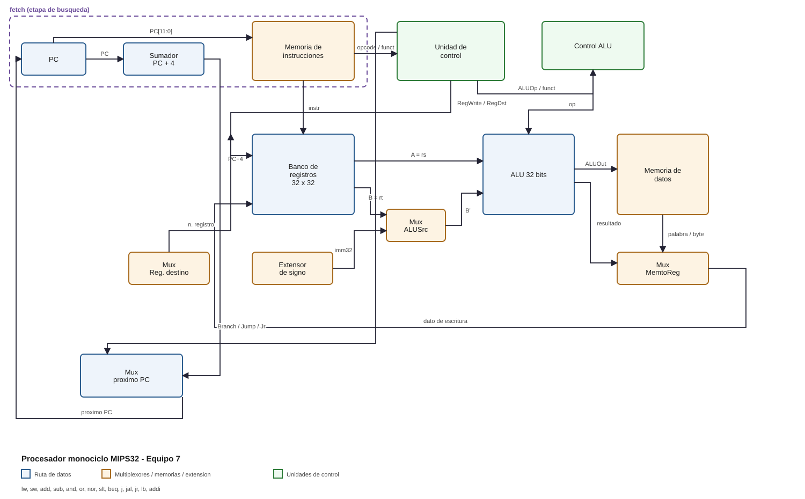

# Laboratorio 03 — Diseño y verificación del procesador monociclo

**Arquitectura de Computadores y Laboratorio — 2026-2**

| | |
|---|---|
| **Equipo** | 7 |
| **Integrantes** | Iván René Acosta Lallemand · Manuel Felipe Álvarez Rúa |
| **Instrucciones adicionales** | `LB` (*load byte*) y `ADDI` (*add immediate*) |
| **Problema asignado** | Primeros diez elementos de `S(n) = 2·S(n-1) + S(n-2)`, `S(0)=0`, `S(1)=1` |
| **Herramienta** | Logisim Evolution 4.1.0 |

---

## 1. Objetivo

Implementar como procesador monociclo una versión reducida de la arquitectura
MIPS32, extendiendo el repertorio básico (`lw`, `sw`, `add`, `sub`, `and`,
`or`, `nor`, `slt`, `beq`, `jump`) con las instrucciones `jal`, `jr`, `lb` y
`addi`, y utilizarlo para resolver el problema asignado escribiendo un
programa en ensamblador que hace uso de procedimientos y de la convención de
registros MIPS.

---

## 2. Arquitectura implementada

### 2.1 Ruta de datos

El diseño es **jerárquico**: el proyecto se organiza en nueve circuitos de
Logisim: `main` y ocho subcircuitos que se instancian entre sí.

- **`main`** — circuito superior; sólo interconecta bloques, con cables ortogonales. Contiene las dos unidades de control, los multiplexores, los extensores de signo, la lógica de salto, la memoria de datos y la instanciación de los ocho subcircuitos.
- **`fetch`** — la etapa de búsqueda: registro PC, sumador `PC+4` y memoria de instrucciones (ROM de 4 K palabras × 32 bits direccionada por byte, `PC[11:0]`). Sus puertos son `nextPC`, `CLK` y `reset` de entrada, y `PC`, `PCplus4` e `Instruction` de salida.
- **`isplit`** — la separación de campos: `Instruction` → `opcode`, `rs`, `rt`, `rd`, `shamt`, `funct`, `imm` (16) y `target` (26).
- **`alu32`** — la ALU de 32 bits: AND, OR, NOR, sumador, restador, comparador con signo para `slt`, multiplexor 8:1 de resultado y detector de cero.
- **`banco_registros`** — los 32 registros de 32 bits, el decodificador de escritura y los dos multiplexores 32:1 de lectura, con `$zero` inmutable.
- **`unidad_control`** — la ROM de control y el divisor de las 13 señales.
- **`control_alu`** — la ROM de control de la ALU (`ALUOp`, `funct` → `op`).
- **`mem_datos`** — la RAM, el índice de palabra, el selector de byte y la extensión de signo de `LB`.
- **`proximo_pc`** — los desplazadores `<<2`, los sumadores, la compuerta de `Branch & Zero` y los multiplexores del próximo PC.

Cada subcircuito expone únicamente sus pines, con la nomenclatura del curso
(`A`, `B`, `ALUOperation` → `Result`, `Zero` en la ALU; `ReadReg1`,
`ReadReg2`, `WriteReg`, `WriteData`, `RegWrite`, `CLK`, `Reset` →
`ReadData1`, `ReadData2` en el banco; `Address`, `WriteData`, `MemWrite`,
`MemRead`, `CLK` → `ReadData`, `ReadDataByte` en la memoria de datos;
`nextPC`, `CLK`, `reset` → `PC`, `PCplus4`, `Instruction` en `fetch`), de modo
que `main` se lee como el diagrama de bloques de la Figura 1. Los bloques
funcionales son:

| Bloque | Implementación |
|---|---|
| Etapa de búsqueda (`fetch`) | Registro PC de 32 bits con *enable* permanente y *clear* asíncrono + sumador `PC+4` + ROM de 4 K palabras × 32 bits direccionada por byte (`PC[11:0]`) |
| Separación de campos (`isplit`) | Tres divisores de bits: `{opcode, rs, rt, rd, shamt, funct}`, `imm[15:0]` y `target[25:0]` |
| Banco de registros | 32 registros de 32 bits + decodificador 5→32 + dos multiplexores 32:1 |
| Extensión de signo | *Bit Extender* 16→32 en modo `sign` |
| ALU | AND, OR, NOR (compuertas de 32 bits), sumador, restador, comparador con signo y multiplexor 8:1 |
| Memoria de datos | RAM de 4 K palabras × 32 bits, lectura asíncrona, escritura en flanco de subida |
| Memoria → registro | Multiplexor 4:1 (ALU / palabra / byte con signo / `PC+4`) |
| Cálculo de saltos | Desplazadores `<<2`, sumador para `beq`, AND/OR para el salto incondicional |



*Figura 1. Diagrama de bloques de la ruta de datos y de las unidades de control.
El recuadro punteado agrupa la etapa de búsqueda, que en el esquemático es el
subcircuito `fetch`; los campos de la instrucción los separa `isplit`, entre la
memoria de instrucciones y el banco/control. El esquemático completo está en
`procesador_monociclo.circ`.*

El PC, el sumador `PC+4` y la memoria de instrucciones se encapsularon en el
subcircuito `fetch`, siguiendo el estilo de bloques del curso: el bloque recibe
`nextPC`, `CLK` y `reset` y entrega `PC`, `PCplus4` e `Instruction`. Esto no
cambia la ruta de datos; sólo cambia dónde vive el PC. `PCplus4` sigue
alimentando el banco de registros (para `jal`), el cálculo de la dirección de
`beq` y el multiplexor `MemtoReg`, mientras que `Instruction` alimenta el
bloque `isplit` y la unidad de control.

Los campos de la instrucción también se encapsularon: `isplit` recibe la
palabra de 32 bits y entrega cada campo por un pin con nombre (`opcode`, `rs`,
`rt`, `rd`, `shamt`, `funct`, `imm` y `target`), en lugar de repartir divisores
de bits dentro de `main`. Todos los bloques usan la apariencia del curso: caja
negra, barra de título inferior y etiquetas de puerto dentro del bloque.

El reloj es un componente `Clock` (10 Hz de simulación) y el reset se controla
con el pin `RST`. Todo el banco de registros y el PC se cargan en el **flanco de
subida**, mientras que las lecturas del banco y de la RAM son **asíncronas**,
lo que hace que cada instrucción se complete en un solo ciclo.

### 2.2 Banco de registros jerárquico

Se instanciaron 32 registros de 32 bits de la biblioteca (`Memory → Register`).
La escritura se habilita con un decodificador 5→32 cuya entrada es el registro
destino y cuyo *enable* es la señal `RegWrite`. Las dos lecturas se hacen con
multiplexores 32:1 controlados por `ReadReg1` y `ReadReg2` (lectura asíncrona).

El registro `$zero` se cableó con `D = 0` y `EN = 1`, por lo que en cada flanco
se recarga con cero y **nunca puede modificarse**; además, el decodificador no
se conecta a su habilitación.

### 2.3 Unidad de control

La unidad de control se implementó como una **ROM combinacional** de 4 K × 16
cuya dirección es `{opcode[5:0], funct[5:0]}`. Para las instrucciones tipo I y
J el campo `funct` se ignora, de modo que la tabla se genera para todas las
combinaciones y la función resulta puramente combinacional. Las señales son:

| bit | señal | significado |
|---|---|---|
| 0 | `RegDst` | 0 → `rt`, 1 → `rd` |
| 1 | `ALUSrc` | 0 → registro `rt`, 1 → inmediato extendido |
| 2–3 | `MemtoReg` | 00 ALU · 01 palabra · 10 byte con signo · 11 `PC+4` |
| 4 | `RegWrite` | escritura del banco |
| 5 | `MemRead` | lectura de la RAM (`OE`) |
| 6 | `MemWrite` | escritura de la RAM (`WE`) |
| 7 | `Branch` | habilitación de `beq` |
| 8 | `Jump` | salto incondicional |
| 9 | `Jal` | escribe `$31` con `PC+4` |
| 10 | `Jr` | salto al registro `rs` |
| 11–12 | `ALUOp` | 00 ADD · 01 SUB · 10 según `funct` |

Tabla de control resultante:

| Instrucción | RegDst | ALUSrc | MemtoReg | RegWrite | MemRead | MemWrite | Branch | Jump | Jal | Jr | ALUOp |
|---|---|---|---|---|---|---|---|---|---|---|---|
| tipo R (`add`, `sub`, `and`, `or`, `nor`, `slt`) | 1 | 0 | 00 | 1 | 0 | 0 | 0 | 0 | 0 | 0 | 10 |
| `jr` | 0 | 0 | 00 | 0 | 0 | 0 | 0 | 0 | 0 | 1 | 00 |
| `addi` | 0 | 1 | 00 | 1 | 0 | 0 | 0 | 0 | 0 | 0 | 00 |
| `lw` | 0 | 1 | 01 | 1 | 1 | 0 | 0 | 0 | 0 | 0 | 00 |
| `lb` | 0 | 1 | 10 | 1 | 1 | 0 | 0 | 0 | 0 | 0 | 00 |
| `sw` | 0 | 1 | 00 | 0 | 0 | 1 | 0 | 0 | 0 | 0 | 00 |
| `beq` | 0 | 0 | 00 | 0 | 0 | 0 | 1 | 0 | 0 | 0 | 01 |
| `j` | 0 | 0 | 00 | 0 | 0 | 0 | 0 | 1 | 0 | 0 | 00 |
| `jal` | 0 | 0 | 11 | 1 | 0 | 0 | 0 | 1 | 1 | 0 | 00 |

El registro destino se selecciona con un multiplexor 4:1
(`rt`, `rd`, `31`, `31`) controlado por `{Jal, RegDst}`: cuando `Jal = 1` se
fuerza `$31`, independientemente del campo `rd` (que en el formato J hace parte
del *target*).

### 2.4 Control de la ALU

Es otra ROM combinacional de 256 × 3 direccionada por `{ALUOp, funct}`. Las
operaciones son: 0 = ADD, 1 = SUB, 2 = AND, 3 = OR, 4 = NOR, 5 = SLT. El
multiplexor de resultado de la ALU es de 8:1 y sus entradas no usadas se
conectan a cero.

`SLT` se resuelve con un comparador de 32 bits en modo complemento a dos
(comparación con signo) y un *Bit Extender* que convierte el bit de resultado
en una palabra de 32 bits (0 o 1). El indicador `Zero` que necesita `beq` se
obtiene comparando el resultado de la ALU con cero.

### 2.5 Instrucciones adicionales

**`ADDI`** (opcode `001000`): se activa `ALUSrc` para que la ALU sume el
registro `rs` con el inmediato extendido con signo; `RegDst = 0` y
`RegWrite = 1` para escribir el resultado en `rt`. `ALUOp = 00` (ADD).

**`LB`** (opcode `100000`): se comporta como `lw` para el cálculo de la
dirección (`rs + signext(imm)`), pero el dato que se escribe en el registro es
el **byte** seleccionado dentro de la palabra leída. La memoria se direcciona
por byte: `ALU[13:2]` es el índice de palabra y `ALU[1:0]` el desplazamiento de
byte. Un `BitSelector` con grupo de 8 bits y selección `ALU[1:0]` extrae el
byte y un *Bit Extender* en modo `sign` lo extiende a 32 bits. La señal
`MemtoReg = 10` selecciona este camino en el multiplexor de escritura.

El direccionamiento por byte es real: `lb` sobre la dirección `0x101` lee el
segundo byte de la palabra almacenada en `0x100`.

---

## 3. Programa solución

### 3.1 Pseudocódigo

```
main:
    escribir configuracion:  memoria[0x200] = 0x0000020A   (byte 0 = N = 10)
    N  = lb(0x200)                    # LB
    base = 0x100
    S(9) = serie(N, base)             # procedimiento
    memoria[0x300] = S(9)
    (suma, cantidad) = checksum(N, base)   # procedimiento
    memoria[0x304] = suma
    memoria[0x308] = cantidad
    leer de vuelta 0x300, 0x304, 0x308 y 0x124 en $s3..$s6
    fin: j fin

serie(N, base):
    guardar $ra, $s1, $s2 en la pila
    s1 = S(0) = 0 ; s2 = S(1) = 1 ; i = 0 ; p = base
    mientras i < N:
        si i == 0:      S = 0
        si i == 1:      S = 1
        si no:          S = 2*s2 + s1 ; s1 = s2 ; s2 = S
        memoria[p] = S ; p = p + 4 ; i = i + 1
    v0 = s2
    restaurar $ra, $s1, $s2 ; jr $ra

checksum(N, base):
    guardar $ra en la pila
    suma = 0 ; cantidad = 0 ; i = 0
    mientras i < N:
        suma = suma + lb(base + 4*i)     # LB con extension de signo
        cantidad = cantidad + 1 ; i = i + 1
    restaurar $ra ; jr $ra
```

### 3.2 Convención de registros

| Registro | Uso en el programa |
|---|---|
| `$zero` | constante 0 |
| `$v0`, `$v1` | valores de retorno de los procedimientos |
| `$a0`, `$a1`, `$a2` | argumentos: `N`, base del arreglo, base de resultados |
| `$t0`–`$t3` | temporales (contadores, punteros, valores intermedios) |
| `$s1`, `$s2` | registros salvados: `S(n-2)` y `S(n-1)` |
| `$s3`–`$s6` | resultados leídos de memoria |
| `$sp`, `$ra` | pila y dirección de retorno |

Los procedimientos salvan y restauran los registros que usan, y usan
`jal`/`jr` para llamar y retornar.

### 3.3 Código ensamblador

Ver el archivo `solucion_lab03.asm`. Consta de 71 instrucciones (284 bytes).

### 3.4 Código de máquina

| Dirección | Código | Instrucción |
|---|---|---|
| `0x00000000` | `0x20080200` | `addi $t0, $zero, 512` |
| `0x00000004` | `0x2009020A` | `addi $t1, $zero, 522` |
| `0x00000008` | `0xAD090000` | `sw $t1, 0($t0)` |
| `0x0000000C` | `0x81040000` | `lb $a0, 0($t0)` |
| `0x00000010` | `0x20050100` | `addi $a1, $zero, 256` |
| `0x00000014` | `0x0C000012` | `jal 0x00000048` |
| `0x00000018` | `0x20060300` | `addi $a2, $zero, 768` |
| `0x0000001C` | `0xACC20000` | `sw $v0, 0($a2)` |
| `0x00000020` | `0x20050100` | `addi $a1, $zero, 256` |
| `0x00000024` | `0x0C000036` | `jal 0x000000D8` |
| `0x00000028` | `0xACC20004` | `sw $v0, 4($a2)` |
| `0x0000002C` | `0xACC30008` | `sw $v1, 8($a2)` |
| `0x00000030` | `0x8CD30000` | `lw $s3, 0($a2)` |
| `0x00000034` | `0x8CD40004` | `lw $s4, 4($a2)` |
| `0x00000038` | `0x8CD50008` | `lw $s5, 8($a2)` |
| `0x0000003C` | `0x20080120` | `addi $t0, $zero, 288` |
| `0x00000040` | `0x8D160004` | `lw $s6, 4($t0)` |
| `0x00000044` | `0x08000011` | `j 0x00000044` |
| `0x00000048` | `0x23BDFFF4` | `addi $sp, $sp, -12` |
| `0x0000004C` | `0xAFBF0008` | `sw $ra, 8($sp)` |
| `0x00000050` | `0xAFB10004` | `sw $s1, 4($sp)` |
| `0x00000054` | `0xAFB20000` | `sw $s2, 0($sp)` |
| `0x00000058` | `0x20110000` | `addi $s1, $zero, 0` |
| `0x0000005C` | `0x20120001` | `addi $s2, $zero, 1` |
| `0x00000060` | `0x20080000` | `addi $t0, $zero, 0` |
| `0x00000064` | `0x00A05820` | `add $t3, $a1, $zero` |
| `0x00000068` | `0x0104482A` | `slt $t1, $t0, $a0` |
| `0x0000006C` | `0x11200014` | `beq  $t1, $zero, 20` |
| `0x00000070` | `0x1100000A` | `beq  $t0, $zero, 10` |
| `0x00000074` | `0x200A0001` | `addi $t2, $zero, 1` |
| `0x00000078` | `0x110A000C` | `beq  $t0, $t2, 12` |
| `0x0000007C` | `0x02525020` | `add $t2, $s2, $s2` |
| `0x00000080` | `0x01515020` | `add $t2, $t2, $s1` |
| `0x00000084` | `0x02408820` | `add $s1, $s2, $zero` |
| `0x00000088` | `0x01409020` | `add $s2, $t2, $zero` |
| `0x0000008C` | `0xAD6A0000` | `sw $t2, 0($t3)` |
| `0x00000090` | `0x216B0004` | `addi $t3, $t3, 4` |
| `0x00000094` | `0x21080001` | `addi $t0, $t0, 1` |
| `0x00000098` | `0x0800001A` | `j 0x00000068` |
| `0x0000009C` | `0xAD600000` | `sw $zero, 0($t3)` |
| `0x000000A0` | `0x216B0004` | `addi $t3, $t3, 4` |
| `0x000000A4` | `0x21080001` | `addi $t0, $t0, 1` |
| `0x000000A8` | `0x0800001A` | `j 0x00000068` |
| `0x000000AC` | `0x200A0001` | `addi $t2, $zero, 1` |
| `0x000000B0` | `0xAD6A0000` | `sw $t2, 0($t3)` |
| `0x000000B4` | `0x216B0004` | `addi $t3, $t3, 4` |
| `0x000000B8` | `0x21080001` | `addi $t0, $t0, 1` |
| `0x000000BC` | `0x0800001A` | `j 0x00000068` |
| `0x000000C0` | `0x02401020` | `add $v0, $s2, $zero` |
| `0x000000C4` | `0x8FBF0008` | `lw $ra, 8($sp)` |
| `0x000000C8` | `0x8FB10004` | `lw $s1, 4($sp)` |
| `0x000000CC` | `0x8FB20000` | `lw $s2, 0($sp)` |
| `0x000000D0` | `0x23BD000C` | `addi $sp, $sp, 12` |
| `0x000000D4` | `0x03E00008` | `jr   $ra` |
| `0x000000D8` | `0x23BDFFFC` | `addi $sp, $sp, -4` |
| `0x000000DC` | `0xAFBF0000` | `sw $ra, 0($sp)` |
| `0x000000E0` | `0x20020000` | `addi $v0, $zero, 0` |
| `0x000000E4` | `0x20030000` | `addi $v1, $zero, 0` |
| `0x000000E8` | `0x20080000` | `addi $t0, $zero, 0` |
| `0x000000EC` | `0x00A05820` | `add $t3, $a1, $zero` |
| `0x000000F0` | `0x0104482A` | `slt $t1, $t0, $a0` |
| `0x000000F4` | `0x11200006` | `beq  $t1, $zero, 6` |
| `0x000000F8` | `0x816A0000` | `lb $t2, 0($t3)` |
| `0x000000FC` | `0x004A1020` | `add $v0, $v0, $t2` |
| `0x00000100` | `0x20630001` | `addi $v1, $v1, 1` |
| `0x00000104` | `0x216B0004` | `addi $t3, $t3, 4` |
| `0x00000108` | `0x21080001` | `addi $t0, $t0, 1` |
| `0x0000010C` | `0x0800003C` | `j 0x000000F0` |
| `0x00000110` | `0x8FBF0000` | `lw $ra, 0($sp)` |
| `0x00000114` | `0x23BD0004` | `addi $sp, $sp, 4` |
| `0x00000118` | `0x03E00008` | `jr   $ra` |

### 3.5 Mapa de memoria

| Dirección | Contenido | Escrito por |
|---|---|---|
| `0x00000200` | `0x0000020A` (byte 0 = 10 = N) | `main` |
| `0x00000100` … `0x00000124` | `S(0)` … `S(9)` | `serie` |
| `0x00000300` | `985` (`S(9)`) | `main` |
| `0x00000304` | `0xFFFFFF91` (checksum) | `main` |
| `0x00000308` | `10` (cantidad) | `main` |

La memoria de datos de Logisim es volátil y arranca en cero; el programa no
requiere datos precargados porque él mismo escribe la configuración inicial.
Ver `memoria_datos_inicial.txt`.

---

## 4. Verificación

### 4.1 Metodología

1. Se escribió un **simulador de referencia** del ISA en Python (`mips_asm.py`) que implementa exactamente las 14 instrucciones con aritmética de 32 bits, extensión de signo y memoria direccionada por byte.
2. Se ensambló el programa y se ejecutó en el simulador hasta el lazo final.
3. Se generó un **vector de prueba de Logisim** que aplica `RST = 1` y luego conmuta el reloj durante todos los ciclos necesarios, comparando al final el PC y los 32 registros del banco contra el simulador. Para poder leerlos, la verificación se corre sobre una versión del mismo diseño que expone los 32 registros y el PC como pines de salida.
4. Se ejecutó el vector con Logisim en modo *headless* (`--test-vector`).
5. Además, se verificó **bloque por bloque** (estilo “Verificación” del curso): cada subcircuito tiene su propio archivo de vectores y se prueba de forma aislada antes del programa completo.

### 4.2 Verificación por bloque

| Bloque | Vectores | Cobertura | Resultado |
|---|---|---|---|
| `isplit` | 71 | un vector por instrucción del programa (todos los campos) | **71 / 71** |
| `unidad_control` | 4096 | las 64 opciones de `opcode` × 64 de `funct` | **4096 / 4096** |
| `control_alu` | 256 | los 4 valores de `ALUOp` × 64 de `funct` | **256 / 256** |
| `alu32` | 56 | 8 operaciones × 7 pares de operandos (incluye signo y cero) | **56 / 56** |
| `fetch` | 13 | reset + 6 instrucciones consecutivas (PC, `PC+4`, `Instruction`) | **13 / 13** |
| `banco_registros` | 11 | reset, escritura/lectura de dos registros y `$zero` inmutable | **11 / 11** |
| `mem_datos` | 9 | escritura/lectura de palabra y de byte con signo | **9 / 9** |

### 4.3 Resultados del programa completo

| Programa | Instrucciones | Ciclos | Vectores | Resultado |
|---|---|---|---|---|
| `solucion_lab03.asm` | 71 | 246 | 513 | **513 / 513 correctos** |
| `pruebas_isa.asm` | 33 | 38 | 97 | **97 / 97 correctos** |

El programa `pruebas_isa.asm` ejercita y verifica cada instrucción por
separado:

| Instrucción | Resultado esperado | Resultado obtenido |
|---|---|---|
| `addi` | `0x00001234`, `0x00000F0F` | correcto |
| `add` | `0x00002143` | correcto |
| `sub` | `0x00000325` | correcto |
| `and` | `0x00000204` | correcto |
| `or` | `0x00001F3F` | correcto |
| `nor` | `0xFFFFE0C0` | correcto |
| `slt` | `1` y `0` (con signo) | correcto |
| `sw` / `lw` | `0x00002143`, `0xFFFFE0C0` | correcto |
| `lb` | `0xFFFFFFC0` (byte `0xC0`) y `0x00000021` | correcto |
| `beq` | tomado y no tomado, offsets ± | correcto |
| `j` | hacia adelante y hacia atrás | correcto |
| `jal` / `jr` | retorno correcto | correcto |

### 4.4 Resultados de ejecución del programa solución

```
S(0..9) = 0, 1, 2, 5, 12, 29, 70, 169, 408, 985

$v0 = 0xFFFFFF91 (-111)   suma de los bytes bajos (LB)
$v1 = 0x0000000A (10)     cantidad de términos
$s3 = 0x000003D9 (985)    S(9) leído de 0x300
$s4 = 0xFFFFFF91 (-111)   checksum leído de 0x304
$s5 = 0x0000000A (10)     cantidad leída de 0x308
$s6 = 0x000003D9 (985)    S(9) leído del arreglo (0x124)
$t3 = 0x00000128          puntero final del arreglo
$ra = 0x00000028
```

El valor `-111` se explica porque `LB` extiende el signo: los bytes bajos
`0xA9`, `0x98` y `0xD9` (de `S(7)`, `S(8)` y `S(9)`) se interpretan como
`-87`, `-104` y `-39`, lo que evidencia el funcionamiento correcto de la
extensión de signo de `LB`.

---

## 5. Decisiones de diseño

- **Control con ROM en lugar de lógica de compuertas.** La guía exige diseñar el control de forma combinacional; una ROM con la tabla de verdad completa es una implementación combinacional canónica, es fácil de auditar y permite agregar instrucciones sin re-cablear. La dirección incluye `opcode` y `funct` para separar `jr` del resto de las instrucciones tipo R.
- **Memoria direccionada por byte.** Es necesaria para que `lb`/`lw`/`sw` compartan el mismo espacio de direcciones y para que `lb` pueda acceder a cualquier byte. Se toma `ALU[13:2]` como índice de palabra y `ALU[1:0]` como selector de byte; esto también evita tener que implementar un *splitter* de direcciones.
- **RAM con lectura asíncrona.** En un procesador monociclo el dato de `lw`/`lb` debe estar disponible en el mismo ciclo; por eso se activa `asyncread`, manteniendo la escritura en el flanco de subida.
- **Etapa de búsqueda encapsulada.** El registro PC, el sumador `PC+4` y la ROM de instrucciones se agruparon en el subcircuito `fetch`, y los campos de la instrucción en `isplit`, que expone cada campo por un pin con nombre. Así `main` se lee como un diagrama de bloques y cada etapa se puede examinar y verificar por separado, sin cambiar el ISA ni el direccionamiento por byte.
- **Verificación por bloque.** Cada subcircuito tiene su propio archivo de vectores (combinacionales de forma exhaustiva, secuenciales con una secuencia de reloj explícita), de modo que un fallo se localiza en el bloque que lo produce y no sólo al final del programa.
- **Cableado ortogonal con túneles auxiliares.** La ruta de datos se dibujó con cables horizontales y verticales, usando carriles exclusivos por red para que no haya uniones accidentales; las 32 salidas del banco llegan a los dos multiplexores 32:1 mediante un abanico de carriles paralelos. Los túneles se usan en los pines de observación y en las redes que el ruteo no puede llevar sin cruces.
- **`$zero` cableado a cero.** Garantiza la semántica MIPS aun si el programa intenta escribir en él.
- **Reset explícito.** Los registros de Logisim arrancan en estado desconocido; el pin `RST` limpia el PC y el banco de registros al inicio.

---

## 6. Conclusiones

- Se implementó y verificó un procesador monociclo MIPS32 que ejecuta las diez instrucciones básicas más `jal`, `jr`, `lb` y `addi`.
- El diseño quedó organizado en nueve circuitos jerárquicos; la etapa de búsqueda se encapsuló en `fetch` (PC, `PC+4` y memoria de instrucciones) y los campos de la instrucción en `isplit`.
- Los bloques usan la apariencia del curso (caja negra con barra de título inferior) y la nomenclatura MIPS de puertos (`ReadReg1`, `WriteData`, `ALUOperation`, `ReadData`, etc.).
- El banco de registros es jerárquico (32 registros de 32 bits), con lectura asíncrona, escritura síncrona y `$zero` inmutable.
- El programa solución usa procedimientos (`jal`/`jr`), respeta la convención de registros y publica sus resultados tanto en el banco de registros como en la memoria de datos.
- La verificación se hizo en dos niveles: cada bloque por separado (4512 vectores en total, sin fallos) y el programa completo contra un simulador de referencia, registro por registro (610 vectores, cero discrepancias).
- La instrucción `LB` resultó especialmente útil para mostrar la diferencia entre una carga de palabra y una carga de byte con extensión de signo.
